I'm An (Yasuko), a Computer Engineering Technology student from Vietnam, and I build software for phones the rest of the world gave up on. Most of my time goes into **YTMusicWP**, a free, open-source YouTube Music client for Windows Phone 8.1 and Windows 10 Mobile.

### 🎵 YTMusicWP

A native YouTube Music app for Lumia phones: background playback without ads, synced word-by-word lyrics, YouTube livestreams, Listen Together rooms, offline downloads, SponsorBlock and Live Tiles. It runs smoothly on a 512 MB Lumia 520.

- **Source:** [Yasukoisreal/YTMusicWP](https://github.com/Yasukoisreal/YTMusicWP)
- **Website:** [yasukoisreal.github.io/YTMusicWP](https://yasukoisreal.github.io/YTMusicWP/)
- **Download:** [latest release](https://github.com/Yasukoisreal/YTMusicWP/releases/latest) · [Live Store](https://store.live.net.co/app/447) · [WinArchive](https://winarchive.org/store/app/?id=1992)

### 🛠️ What I work with

C# · XAML · Windows Runtime (WP8.1 / UWP) · streaming protocols (SABR/UMP) · squeezing apps into 512 MB of RAM

### ❤️ Support

YTMusicWP is free and has no ads. If it brought your Lumia back to life, you can support its development:

